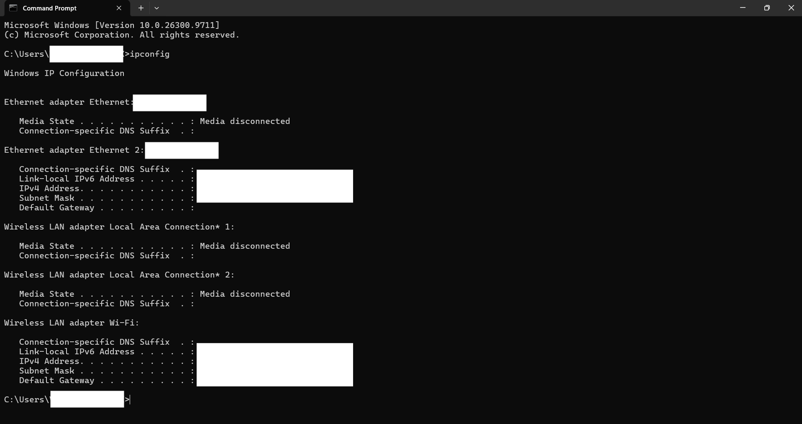
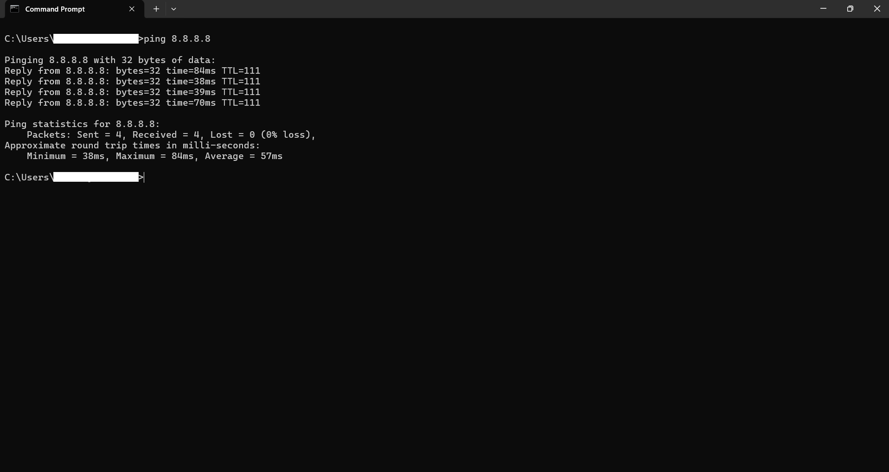
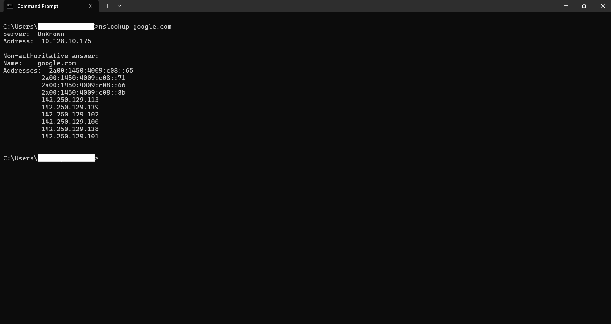

# Windows Networking Basics

A hands-on introduction to Windows networking utilities, completed as part of my cybersecurity learning journey.

This project demonstrates how to inspect network configurations, test network connectivity, and investigate Domain Name System (DNS) resolution using Windows Command Prompt.

## Table of Contents

- [Project Overview](#project-overview)
- [Objectives](#objectives)
- [Tools Used](#tools-used)
- [Practical Exercises](#practical-exercises)
  - [1. IP Configuration](#1-ip-configuration---ipconfig)
  - [2. Connectivity Testing](#2-connectivity-testing---ping)
  - [3. DNS Lookup](#3-dns-lookup---nslookup)
- [Key Concepts Learned](#key-concepts-learned)
- [Challenges and Observations](#challenges-and-observations)
- [Conclusion](#conclusion)

## Project Overview

This project documents my first hands-on networking practical as part of my cybersecurity learning journey.

Using Windows Command Prompt, I explored three fundamental networking utilities:

- `ipconfig` – Examining network configuration.
- `ping` – Testing network connectivity.
- `nslookup` – Investigating DNS resolution.

These exercises helped me understand how computers identify themselves on networks, communicate with other devices, and translate domain names into IP addresses.

## Objectives

- Understand basic network configuration.
- Identify IP addresses, subnet masks, and default gateways.
- Test connectivity to external network destinations.
- Understand how DNS translates domain names into IP addresses.
- Gain practical experience using Windows networking commands.

## Tools Used

| Tool | Purpose |
|---|---|
| Windows Command Prompt (CMD) | Executing networking commands |
| `ipconfig` | Viewing network configuration |
| `ping` | Testing network reachability |
| `nslookup` | Querying DNS records |

## Practical Exercises

### 1. IP Configuration - `ipconfig`

**Command:**

```cmd
ipconfig
```

**Purpose:**

The `ipconfig` command displays the TCP/IP network configuration of a Windows computer.

It provides information such as:

- IPv4 address: Identifies the computer on an IP network.
- Subnet mask: Determines which portion of an IP address identifies the network and which identifies the host.
- Default gateway: The device that forwards traffic from the local network to other networks.

**Findings:**

- Identified my active Wi-Fi network adapter.
- Examined its IPv4 address.
- Identified the subnet mask and default gateway.
- Observed other network adapters, including disconnected adapters.

**Screenshot:**



### 2. Connectivity Testing - `ping`

**Command:**

```cmd
ping 8.8.8.8
```

**Purpose:**

The `ping` command tests network reachability by sending Internet Control Message Protocol (ICMP) Echo Requests to a destination and waiting for Echo Replies.

I used Google's public DNS server IP address (`8.8.8.8`) as the destination.

**Findings:**

| Measurement | Result |
|---|---:|
| Packets sent | 4 |
| Packets received | 4 |
| Packets lost | 0 |
| Packet loss | 0% |
| Average response time | 57 ms |

**Interpretation:**

The test was successful because all four packets received replies.

The 0% packet loss indicates that no packets were lost during this particular test. The average response time of 57 milliseconds represents the average round-trip time for the packets.

**Screenshot:**



### 3. DNS Lookup - `nslookup`

**Command:**

```cmd
nslookup google.com
```

**Purpose:**

The `nslookup` command queries the Domain Name System (DNS) to retrieve information about domain names.

DNS acts like a directory for the internet, translating human-readable domain names into IP addresses that computers use to communicate.

**Findings:**

- Successfully resolved `google.com`.
- Retrieved IPv4 and IPv6 address information.
- Identified the DNS server used to perform the lookup.

**Interpretation:**

The successful lookup demonstrated that DNS resolution was working during the test. It showed how a domain name can be translated into IP address information.

**Screenshot:**



## Key Concepts Learned

Through these practical exercises, I developed a better understanding of the following networking concepts:

1. **IP Address:** A numerical address used to identify a device on an IP network.
2. **Subnet Mask:** Defines the network and host portions of an IPv4 address.
3. **Default Gateway:** Provides a route from a local network to other networks.
4. **Network Connectivity:** Describes the ability of devices to communicate over a network.
5. **Packet Loss:** Occurs when transmitted packets fail to reach their destination or return successfully.
6. **Latency:** The time taken for data to travel between two network endpoints and back.
7. **DNS Resolution:** The process of translating domain names into IP addresses.

## Challenges and Observations

- Different network adapters can appear in the same computer, even when some are disconnected.
- A successful ping to an external IP address demonstrates reachability to that destination, but does not guarantee that every internet service is accessible.
- DNS resolution allows users to access websites using domain names instead of memorizing IP addresses.
- Networking commands provide useful diagnostic information when troubleshooting connectivity problems.

## Conclusion

This practical provided an introduction to fundamental networking concepts through hands-on experience with Windows Command Prompt.

By using `ipconfig`, `ping`, and `nslookup`, I learned how to inspect network configurations, test connectivity, and understand DNS resolution.


---

**Project:** Windows Networking Basics  
**Focus:** Computer Networking Fundamentals  
**Environment:** Windows Command Prompt  
**Repository:** [Windows Networking Basics](https://github.com/malinzex/Windows-Networking-Basics)
